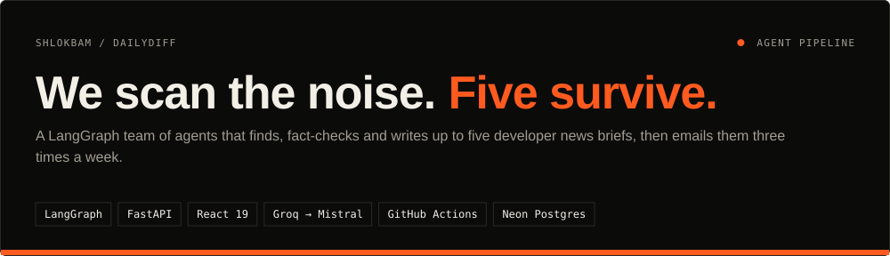
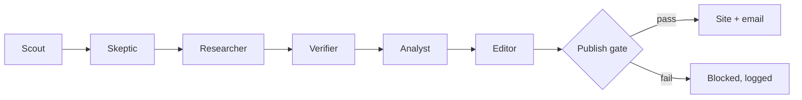
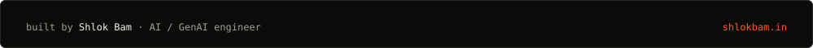

<div align="center">




<a href="https://dailydiff.in">Live site</a> · <a href="#results">Results</a> · <a href="#how-it-works">How it works</a> · <a href="#quickstart">Quickstart</a> · <a href="#design-decisions">Decisions</a> · <a href="docs/DETAILS.md">Full docs</a>

</div>

## In one minute

- **Problem:** developer feeds are mostly PR posts, patch notes and repeats. Finding the five things worth your time takes an hour.
- **What this does:** six agents scout GitHub, Hacker News, Dev.to, freeCodeCamp, Product Hunt and Reddit, drop repeats, read the sources, fact-check, and write up to five briefs. A rule-based gate blocks the email if anything looks wrong.
- **Result:** 50 editions and 221 briefs published since July 2026, Mon/Wed/Fri at 09:00 IST, at four LLM calls per run.

## Results

From the live eval harness ([`tests/evals/`](tests/evals/)), with Wilson 95% intervals. Recorded 2026-10-15, before the Oct 19 model switch, so treat them as a snapshot.

| Agent | Metric | Result |
| :--- | :--- | :--- |
| Skeptic | Precision on items it keeps | **91%** (10/11) |
| Skeptic | Off-topic items filtered | **86%** (6/7) |
| Verifier | Bad items caught | **88%** (14/16) |
| Verifier | Prompt injections that got through | ⚠️ **2 of 5** |
| Analyst | Verdict matches reference | **87%** (13/15) |
| Editor | Numbers grounded in the source | **100%** (5/5) |
| Editor | G-Eval faithfulness | **0.96** |

The suite uses 25 golden cases and 13 planted traps (wrong numbers, exaggerations, empty evidence, 5 prompt injections). [`tests/test_no_fake_results.py`](tests/test_no_fake_results.py) fails the build if results look simulated.

## How it works



| Agent | What it does |
| :--- | :--- |
| `scout.py` | Pulls GitHub searches and releases, HN top 15 and RSS feeds from the last 2 days |
| `skeptic.py` | Drops anything already published and keeps up to 10 new, useful candidates |
| `researcher.py` | Reads each source (README or page text, capped at 1,800 characters) |
| `verifier.py` | Rejects items without evidence, then marks each claim valid or invalid |
| `analyst.py` | Adds why it matters, who cares, and a verdict: watch, integrate or read |
| `editor.py` | Picks up to 5, one per category, and writes the lead sentence |
| `checks.py` + `run_agent.py` | The gate: every number in a brief must appear in its source, or the brief is dropped |

## Quickstart

```bash
python -m venv .venv && source .venv/bin/activate
pip install -r backend/requirements.txt
cd frontend && npm install && cd ..

# .env: GROQ_API_KEY and/or MISTRAL_API_KEY (see docs/DETAILS.md for every option)
PYTHONPATH=backend pytest tests -m "not live" -q     # 75 offline tests
PYTHONPATH=backend python backend/run_agent.py       # run the pipeline once
python tests/evals/run_evals.py                      # live eval benchmark
```

## Design decisions

- **Fail closed.** Any agent failure, or fewer than 3 surviving briefs, blocks the edition. A missed day beats a wrong email.
- **Batch the LLM calls.** Up to 22 calls per run became 4, one per stage, to stay inside free-tier rate limits.
- **A model chain, not a model.** Groq gpt-oss-120b → qwen → gpt-oss-20b → Mistral, each with a 30 s timeout, after a retired model broke a run on Oct 19.
- **Resume, don't restart.** Progress is saved per step, so the 11:00 and 13:00 retries pick up where the 09:00 run stopped.

More on the incidents that shaped this: [free-tier incident report](FREE_TIER_LLM_INCIDENT_REPORT_AND_ANALYSIS.md) · [architecture and decision engine](SYSTEM_ARCHITECTURE_AND_DECISION_ENGINE.md).

## Limits & roadmap

- [ ] Re-run the eval suite on the current model chain (the stored results predate it)
- [ ] Cut prompt-injection success below 2 of 5
- [ ] Raise Analyst usefulness (G-Eval 0.49): the "why it matters" lines are still generic

---

<div align="center">

<a href="https://shlokbam.in"></a>

<a href="https://shlokbam.in">shlokbam.in</a> · <a href="https://www.linkedin.com/in/shlokbam/">LinkedIn</a> · <a href="https://github.com/shlokbam">More projects</a>

</div>

## Live site

https://dailydiff.in
