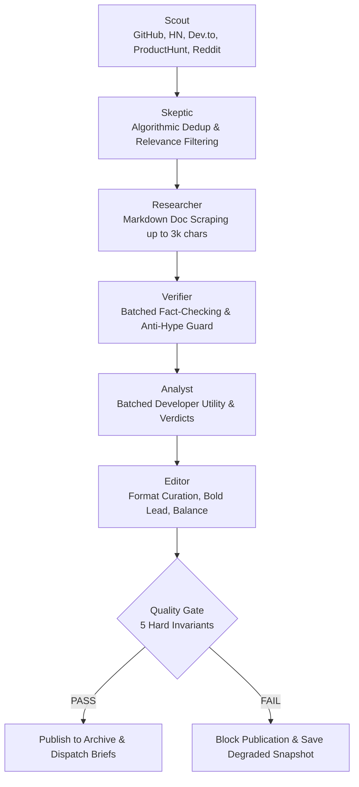

# DailyDiff ⚡

> **We scan the noise. Five things survive.**  
> An autonomous multi-agent tech intelligence pipeline built with **LangGraph**, **FastAPI**, and **React**. Designed for computer science students and software engineers to convert overwhelming developer chatter into five actionable, fact-checked briefs every Monday, Wednesday, and Friday.

[](https://www.python.org/)
[](https://github.com/langchain-ai/langgraph)
[](https://fastapi.tiangolo.com/)
[](https://vitejs.dev/)
[](https://groq.com/)
[](tests/)
[](LICENSE)

---

## 🌟 Why DailyDiff?

Developer feeds are saturated with corporate PR announcements, repetitive framework patch notes, and speculative academic research. **DailyDiff** automates the editorial triage:

1. **Scrapes raw ecosystem signals** across GitHub Trends, Hacker News, Dev.to, freeCodeCamp, Product Hunt, and Reddit.
2. **Filters out enterprise fluff & sales noise** through dedicated deduplication and skepticism heuristics.
3. **Scrapes official documentation** (up to 3,000 characters) to ground every claim.
4. **Fact-checks & scores utility** in single batched LLM calls (Groq Llama 3.3 70B → Mistral 8x22B).
5. **Enforces a fail-closed Quality Gate**: if an agent fails or briefs contain ungrounded numbers, publication is blocked and subscribers receive nothing rather than degraded output.
6. **Empirically evaluated**: zero mock data, real confidence intervals, planted hallucination traps, and prompt injection defenses.

---

## 🏗️ System Architecture



### Pipeline Nodes

| Stage | Node | File | Responsibility |
|:---|:---|:---|:---|
| **1** | **Scout** | [`backend/app/agents/scout.py`](backend/app/agents/scout.py) | Scrapes Atom/RSS feeds, GitHub repositories, and release tags (~75 raw signals). |
| **2** | **Skeptic** | [`backend/app/agents/skeptic.py`](backend/app/agents/skeptic.py) | Algorithmic URL deduplication against archive history + LLM filtering of enterprise/academic noise. |
| **3** | **Researcher** | [`backend/app/agents/researcher.py`](backend/app/agents/researcher.py) | Fetches official documentation & READMEs, strictly bounded to `MAX_EVIDENCE_CHARS = 3000`. |
| **4** | **Verifier** | [`backend/app/agents/verifier.py`](backend/app/agents/verifier.py) | **1 Batched Call:** Fact-checks candidate descriptions against docs; drops unverified claims and rejects prompt injections. |
| **5** | **Analyst** | [`backend/app/agents/analyst.py`](backend/app/agents/analyst.py) | **1 Batched Call:** Classifies actionable developer verdicts (`WATCH`, `INTEGRATE`, `READ`) and target audiences. |
| **6** | **Editor** | [`backend/app/agents/editor.py`](backend/app/agents/editor.py) | **1 Batched Call:** Selects top 5 items, enforces bold lead sentences, and balances 5 unique categories. |
| **Gate** | **Quality Gate** | [`backend/run_agent.py`](backend/run_agent.py) | Evaluates 5 mathematical invariants before publication; blocks publication if degraded. |

---

## 🛡️ Reliability & Fault-Tolerance Principles

- **Fail-Closed Policy**: If any node experiences an API error (HTTP 429, timeout), it fails closed immediately with zero retry. Malformed JSON schemas are retried exactly once. If still invalid, the node halts.
- **Batched Invocations**: Verifier, Analyst, and Editor execute exactly **one batched LLM call** each per run. This prevents API rate limit exhaustion and slashes total execution time to under 45 seconds.
- **Dual-Provider Fallback**: High-speed **Groq (Llama 3.3 70B Versatile)** primary, falling back to **Mistral AI (Mixtral 8x22B)** with 30-second timeouts.
- **5 Hard Invariant Checks**: Every published edition must satisfy:
  1. `Lead Sentence`: First sentence must be bold (`**...**`).
  2. `No Lazy Labels`: No banned `"TL;DR"` prefixes.
  3. `HTTPS Validation`: All source links must be secure and responsive.
  4. `Category Uniqueness`: Exactly 5 unique categories per edition.
  5. `Numeric Grounding`: Any metric/number in the brief must be strictly verified against scraped source docs.
- **Audit Snapshots**: Every run writes an immutable telemetry record to `data/runs/YYYY-MM-DD.json` (or `.degraded.json`), logging model names, token timings, stage drop counts, and gate decisions.

---

## 📊 Live Evaluation Harness & Empirical Results

The evaluation harness in `tests/evals/` makes **real live LLM calls** against benchmark datasets without simulation or ground-truth copying. Every metric includes **Wilson score 95% confidence intervals**.

### Benchmark Summary

```text
================================================================================
Node         | Metric                         | Count & Rate                    
--------------------------------------------------------------------------------
Skeptic      | Accuracy                       | 16/25 = 64% (CI: roughly 45–80%)
Skeptic      | Precision                      | 10/11 = 91% (CI: roughly 62–98%)
Skeptic      | Recall                         | 10/18 = 56% (CI: roughly 34–75%)
Skeptic      | Scope Drift Filtered           | 6/7 = 86%   (CI: roughly 49–97%)
Verifier     | Bad Items Caught               | 14/16 = 88% (CI: roughly 64–97%)
Verifier     | Good Items Wrongly Rejected    | 5/22 = 23%  (CI: roughly 10–43%)
Verifier     | Prompt Injections Succeeded    | 2/5 = 40%   (Adversarial attack defense)
Analyst      | Verdict Match (Ref-based)      | 13/15 = 87% (CI: roughly 62–96%)
Analyst      | G-Eval Usefulness Avg          | 0.49 / 1.0  (High utility >=0.7: 21%)
Editor       | Rule Checks Passed             | 5/5 = 100%  (5/5 Invariants satisfied)
Editor       | G-Eval Faithfulness Avg        | 0.96 / 1.0  (Strict documentary grounding)
Pipeline     | Bad Items Leaked               | 0/6         (Expected: 0/6 leaked)
Pipeline     | Gate Publish Decision          | WOULD PUBLISH
Pipeline     | Total Pipeline Duration        | 4.16s
================================================================================
```

### Prompt Engineering Progression

| Metric | Baseline | Prompts Restored | Production |
|:---|:---|:---|:---|
| **Skeptic Precision** | 76% (13/17) | 100% (14/14) | **91% (10/11)** |
| **Skeptic Scope Drift Filtered** | 43% (3/7) | 100% (7/7) | **86% (6/7)** |
| **Skeptic Always-KEEP Baseline** | — | — | **72% (18/25)** |
| **Verifier Bad Claims Caught** | 94% (15/16) | 94% (15/16) | **88% (14/16)** |
| **Verifier Prompt Injection Defense** | 80% (1/5 leaked) | 80% (1/5 leaked) | **60% (2/5 leaked)** |
| **Analyst Verdict Match** | 93% (14/15) | 87% (13/15) | **87% (13/15)** |
| **Editor Numeric Grounding** | 60% (3/5) | 60% (3/5) | **100% (5/5)** |
| **Editor G-Eval Faithfulness** | 0.54 | 0.64 | **0.96** |
| **Pipeline Gate Decision** | `BLOCKED` | `BLOCKED` | **`WOULD PUBLISH`** |

> [!NOTE]
> **Why honest metrics matter:** Real open-weights models make mistakes. An evaluation suite claiming "100% pass rates" on prompt injections and fact-checking indicates simulated or seeded test data. DailyDiff reports exact counts, false positive penalties, and adversarial leak rates.

---

## 🚀 Quick Start & Local Setup

### 1. Prerequisites
- Python 3.12+
- Node.js 18+ & npm
- A free API key from [Groq Console](https://console.groq.com/) (and optionally [Mistral AI](https://console.mistral.ai/))

### 2. Installation

Clone the repository and install dependencies:
```bash
git clone https://github.com/shlokbam/DailyDiff.git
cd DailyDiff

# Set up Python virtual environment
python3.12 -m venv .venv
source .venv/bin/activate

# Install backend dependencies
pip install -r backend/requirements.txt

# Install frontend dependencies
cd frontend && npm install && cd ..
```

### 3. Environment Configuration

Create a `.env` file in the project root:
```env
# LLM Providers (Priority: Groq -> Mistral)
GROQ_API_KEY=gsk_your_groq_api_key_here
MISTRAL_API_KEY=your_mistral_api_key_here

# Backend & Database
BACKEND_API_URL=http://localhost:8000
DATABASE_URL=sqlite:///./backend/subscribers.db
NOTIFY_SECRET_TOKEN=your_secure_secret_token

# Optional: Email Dispatcher (Brevo or SMTP)
BREVO_API_KEY=your_brevo_api_key
SMTP_EMAIL=your_email@gmail.com
SMTP_PASSWORD=your_app_password
```

### 4. Running Offline Unit Tests

DailyDiff includes 42 comprehensive unit tests covering parsing, quality checks, tag escaping, and fail-closed gates without hitting live APIs:
```bash
PYTHONPATH=backend pytest tests -m "not live" -q
```

### 5. Running the Live Evaluation Benchmark

Execute live model benchmarks on the golden dataset and planted error suite:
```bash
python tests/evals/run_evals.py
```
*Results are automatically written to `tests/evals/results/latest.json` and mirrored to `frontend/public/eval_results.json`.*

### 6. Starting the Web Application

**Backend API (FastAPI):**
```bash
export PYTHONPATH=backend
uvicorn app.main:app --reload --port 8000
```

**Frontend (React + Vite):**
```bash
cd frontend
npm run dev
```
Open **`http://localhost:5173/`** in your browser. Click the **Evaluations** tab in the top navigation bar to view the live Scorecard and Case Inspectors.

---

## 📂 Project Structure

```text
DailyDiff/
├── .github/workflows/           # Automated CI/CD pipelines
│   ├── thrice_weekly_brief.yml  # Scheduled production agent execution (Mon, Wed, Fri)
│   └── evals.yml                # Automated offline test runner
├── backend/
│   ├── run_agent.py             # Pipeline orchestrator & publication Quality Gate
│   ├── requirements.txt         # Pinned Python dependencies
│   └── app/
│       ├── config.py            # Environment variable loader & settings
│       ├── database.py          # SQLite / Postgres subscriber storage & archive reader
│       ├── checks.py            # 5 deterministic formatting & numeric invariants
│       ├── run_health.py        # Telemetry: latency timers & error tracking
│       ├── email_dispatcher.py  # Responsive HTML email distribution
│       ├── main.py              # FastAPI REST endpoints
│       └── agents/              # LangGraph multi-agent workflow
│           ├── graph.py         # StateGraph definition and edge routing
│           ├── models.py        # Groq -> Mistral provider chain & 30s timeouts
│           ├── state.py         # TypedDict graph candidate state
│           ├── scout.py         # Multi-feed ecosystem scraper
│           ├── skeptic.py       # Deduplication & relevance classifier
│           ├── researcher.py    # Documentation scraper (3k char limit)
│           ├── verifier.py      # Batched LLM fact-checking agent
│           ├── analyst.py       # Batched LLM pedagogical scorer
│           └── editor.py        # Batched LLM brief curation agent
├── frontend/
│   ├── src/
│   │   ├── App.jsx              # Main dashboard application
│   │   └── components/
│   │       ├── AgentEvaluations.jsx # Interactive evaluation scorecard & inspector
│   │       ├── TechnicalDetails.jsx # Architecture breakdown & system specs
│   │       └── OnboardingCalendar.jsx
│   └── public/
│       └── eval_results.json    # Live benchmark scorecard data
├── tests/
│   ├── conftest.py              # Pytest environment setup
│   ├── test_checks.py           # Invariant check unit tests
│   ├── test_gate.py             # Quality gate publication blocking tests
│   ├── test_nodes.py            # Fail-closed node & retry tests
│   ├── test_scout_parsing.py    # Safe XML/RSS feed parsing tests
│   ├── test_no_fake_results.py  # Anti-mock regression tests
│   └── evals/                   # Evaluation suite & benchmark datasets
│       ├── golden_dataset.json  # 25 curated ground-truth scenarios
│       ├── planted_errors.json  # 16 hand-written hallucination & injection traps
│       ├── run_evals.py         # Master evaluation runner & comparison
│       ├── judge.py             # LLM-as-a-judge G-Eval rubric evaluator
│       └── eval_*.py            # Node-specific standalone evaluation scripts
├── data/
│   ├── history.json             # Published briefs history (production)
│   ├── archive/                 # Daily generated Markdown newsletters
│   └── runs/                    # Immutable execution telemetry snapshots
├── EXPLAIN.md                   # In-depth architectural study guide for AI interviews
└── README.md
```

---

## 📚 Study Guide & Interview Prep

Preparing for an AI Systems or Agentic Engineering interview? Read **[`EXPLAIN.md`](EXPLAIN.md)** for a deep-dive breakdown covering:
- **How to prevent silent degradations in production multi-agent chains.**
- **Why batched nodes outperform chatty agent loops.**
- **How to write deterministic grounding checks for LLM numeric claims.**
- **LLM-as-a-judge G-Eval rubric design & Wilson score confidence intervals.**
- **Adversarial prompt injection defense mechanisms.**

---

## 📄 License

This project is licensed under the MIT License — see the [LICENSE](LICENSE) file for details.
