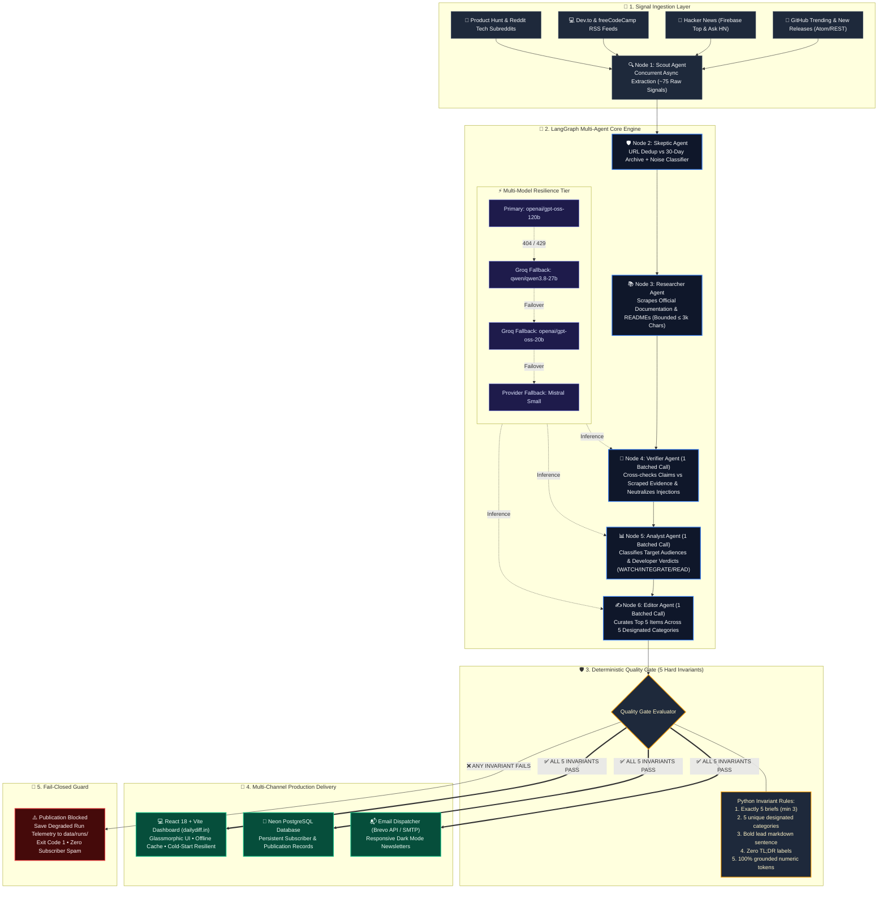

# DailyDiff: System Architecture & Decision Rules Engine

> **Document Version:** 1.0  
> **Status:** Active Production Specification  
> **Core Principle:** Fail-Closed Autonomous Tech Intelligence with Deterministic Quality Gates.

---

## 1. Executive Summary

DailyDiff is an autonomous multi-agent tech intelligence system designed to scrape, filter, fact-check, and publish five high-signal developer updates every Monday, Wednesday, and Friday.

Unlike traditional LLM pipelines that prioritize uptime at the expense of output accuracy ("green builds publishing hallucinated summaries"), DailyDiff enforces a **Fail-Closed Architecture**:
1. If an agent crashes, API limits are exhausted, or an LLM hallucinates ungrounded numbers, **publication is completely blocked**.
2. **Zero emails are sent and zero corrupted briefs are published** to the live website.
3. Every execution leaves an immutable telemetry snapshot in `data/runs/` for full auditability.

---

## 2. Complete End-to-End System Architecture



---

## 3. The 6 Pipeline Nodes & Responsibilities

| Stage | Node | File | Input State | Output State | Key Responsibilities & Invariants |
| :--- | :--- | :--- | :--- | :--- | :--- |
| **1** | **Scout** | [`backend/app/agents/scout.py`](backend/app/agents/scout.py) | *None (External Web)* | `raw_signals` (~75 items) | Concurrent async fetching across 6 feeds. Normalizes titles, dates, and canonical source URLs. |
| **2** | **Skeptic** | [`backend/app/agents/skeptic.py`](backend/app/agents/skeptic.py) | `raw_signals` | `candidates` (~20 items) | **Algorithmic Dedup:** Drops any URL seen in last 30 days of `history.json`.<br/>**LLM Filter:** Filters out enterprise sales pitches, crypto hype, and academic preprints. |
| **3** | **Researcher** | [`backend/app/agents/researcher.py`](backend/app/agents/researcher.py) | `candidates` | `researched_candidates` | Scrapes official HTML / README docs. Strictly bounds text to `MAX_EVIDENCE_CHARS = 3,000` to prevent token bloat and hallucination drift. |
| **4** | **Verifier** | [`backend/app/agents/verifier.py`](backend/app/agents/verifier.py) | `researched_candidates` | `vetted_candidates` | **1 Batched Call:** Verifies candidate descriptions against scraped evidence. Drops ungrounded claims and neutralizes adversarial prompt injections. |
| **5** | **Analyst** | [`backend/app/agents/analyst.py`](backend/app/agents/analyst.py) | `vetted_candidates` | `vetted_candidates` (annotated) | **1 Batched Call:** Classifies actionable verdicts (`WATCH`, `INTEGRATE`, `READ`) and target audiences (`who_cares`). |
| **6** | **Editor** | [`backend/app/agents/editor.py`](backend/app/agents/editor.py) | `vetted_candidates` | `final_briefs` (5 items) | **1 Batched Call:** Curates exactly 5 briefs across 5 distinct categories, enforces bold lead markdown sentences, and strips TL;DR tags. |
| **Gate** | **Quality Gate** | [`backend/run_agent.py`](backend/run_agent.py) | `final_briefs` + Evidence | `data/history.json` or `*.degraded.json` | Deterministic verification of 5 mathematical invariants. Blocks publication if degraded. |

---

## 4. The 5 Strict Quality Gate Invariants

Every candidate edition must satisfy all five deterministic checks in [`backend/app/checks.py`](backend/app/checks.py) before publication:

```python
# 1. Brief Count Invariant
assert len(final_briefs) >= 3 and len(final_briefs) <= 5

# 2. Category Diversity Invariant
DESIGNATED_CATEGORIES = {"Tech Shift", "Cool Tool", "Career & Learning", "Ecosystem Update", "Watchlist"}
assert len(set(b["category"] for b in final_briefs)) == len(final_briefs)
assert all(b["category"] in DESIGNATED_CATEGORIES for b in final_briefs)

# 3. Formatting Invariant: Bold Lead Sentence
assert all(b["description"].strip().startswith("**") and "**" in b["description"][2:] for b in final_briefs)

# 4. Anti-Pattern Invariant: No TL;DR Labels
assert all("tl;dr:" not in b["description"].lower() and "tldr:" not in b["description"].lower() for b in final_briefs)

# 5. Factual Grounding Invariant: Verbatim Numeric Token Matching
for brief in final_briefs:
    numeric_tokens = re.findall(r"\b\d+(?:\.\d+)?(?:x|%|ms|s|kb|mb|gb)?\b", brief["description"], re.IGNORECASE)
    for token in numeric_tokens:
        assert token.lower() in scraped_evidence[brief["source_url"]].lower()
```

---

## 5. Comprehensive Failure Scenarios & Decision Engine

The following decision rules dictate how the system handles every possible failure case across infrastructure, scraping, agent reasoning, and publication gates.

### Exhaustive Decision Matrix

| # | Failure Scenario | Trigger Condition | Root Cause | Immediate Action | Rewind Target | State Mutation | Hard Limit |
| :--- | :--- | :--- | :--- | :--- | :--- | :--- | :--- |
| **1** | **Scout Scraper Timeout** | RSS feed or GitHub API returns `503` / timeout | External network outage | Ignore failing source; pool from surviving 5 sources | None (Continue) | Set warning flag in `health.warnings` | If total signals < 15, halt with code 1 |
| **2** | **Full Scout Failure** | Total `raw_signals == 0` | GitHub rate limit / total network disconnect | **Halt immediately** | None | Record `counts.raw_signals = 0` in degraded snapshot | 0 retries (Fatal) |
| **3** | **Archive Dedup Saturation** | 100% of signals dropped in Skeptic | All top trending repos were already published in past 30 days | Widen search window from 24h to 72h | **Node 1 (Scout)** | `scout_search_window_days = 3` | Max 1 retry |
| **4** | **Skeptic Model 404** | Groq returns `model_not_found` | Model ID deprecated by provider | **Auto-switch model in-memory** | Current Node | Retry with `qwen/qwen3.8-27b` | Sub-second fallback chain |
| **5** | **Provider Quota Depleted** | Provider returns `429: Quota exceeded` | Daily free tier tokens exhausted | **Failover to secondary provider** | Current Node | Route prompt to Mistral Small / fallback pool | Sub-second fallback chain |
| **6** | **All Providers Offline** | All fallback models return 429/timeout | Upstream cloud provider outage | **Fail Closed (`sys.exit(1)`)** | None | Write `data/runs/YYYY-MM-DD.degraded.json` | 0 retries |
| **7** | **Researcher Scrape 404** | Target page returns 404 or Cloudflare bot wall | Ephemeral link or scraper block | Drop candidate evidence; mark as ungrounded | Next Candidate | Candidate removed from `researched_candidates` | Skip individual link |
| **8** | **All Docs Blocked** | `len(researched_candidates) == 0` | Cloudflare blocking scraper IP across all links | **Halt immediately** | None | Log scraping blockade in degraded telemetry | 0 retries |
| **9** | **Prompt Injection Trap** | Candidate contains instruction to ignore system prompt | Malicious repository README | **Neutralize claim; drop candidate** | Continue | Flag injection attempt; reject candidate from `vetted_candidates` | Drop candidate |
| **10** | **Verifier Rejection Deficit** | `len(vetted_candidates) < 3` | Candidates made ungrounded claims that docs didn't support | **Halt immediately** (Insufficient verified facts) | None | Log `"Insufficient briefs: produced 0 briefs"` | 0 retries (Safety first) |
| **11** | **Analyst Schema Malformation** | LLM output fails JSON parsing | Random model output token glitch | **Auto-retry once with strict JSON prompt** | Current Node | Append `"IMPORTANT: Return ONLY valid JSON"` | Max 1 retry |
| **12** | **Editor Duplicate Categories** | Editor outputs 2 briefs with category "Cool Tool" | Model overlooked category uniqueness constraint | **Quality Gate drops duplicates**; if count < 3, **Rewind to Editor** | **Node 6 (Editor)** | Pass feedback: `"Category collision detected: ['Cool Tool']. Select distinct categories."` | Max 1 retry |
| **13** | **Missing Bold Lead** | Brief description does not start with `**...**` | LLM neglected markdown lead formatting rule | **Rewind to Editor with exact formatting prompt** | **Node 6 (Editor)** | Pass feedback: `"Brief missing bold lead sentence. Prepend **Key Takeaway.** to description."` | Max 1 retry |
| **14** | **TL;DR Label Detected** | Description contains `"TL;DR:"` | LLM hallucinated conversational summary tag | **Rewind to Editor** | **Node 6 (Editor)** | Strip tag deterministically via regex or request re-write | Max 1 retry |
| **15** | **Ungrounded Number Token** | Brief mentions `"50x"` but doc only says `"faster"` | LLM numerical hallucination | **Drop individual brief**; if remaining < 3, **Rewind to Editor** | **Node 6 (Editor)** | Pass feedback: `"Ungrounded claim: '50x' not in docs. Choose an alternative candidate."` | Max 1 retry |
| **16** | **Sub-threshold Surviving Briefs** | Fewer than 3 briefs survive Quality Gate | High noise day or strict filter drops | **Halt and record degraded telemetry** | None | Output saved to `data/runs/YYYY-MM-DD.degraded.json` | 0 retries (Block publication) |

---

## 6. Self-Healing vs. Fail-Closed: How Python Executes Recovery

When an anomaly occurs, the Python runner executes the following deterministic recovery logic:

```python
def quality_gate_decision_engine(state: GraphState) -> Tuple[str, List[str]]:
    """
    Evaluates execution health and decides:
    1. 'PUBLISH' -> All invariants satisfied
    2. 'RETRY_EDITOR' -> Good research available; formatting/category collision repairable
    3. 'FAIL_CLOSED' -> Fatal API failure or insufficient grounded facts
    """
    health = state.get("run_health")
    vetted_candidates = state.get("vetted_candidates", [])
    final_briefs = state.get("final_briefs", [])
    
    # 1. Fatal: Hard node failure with exhausted retries
    if health.has_unrecoverable_failures:
        return "FAIL_CLOSED", health.failure_reasons

    # 2. Run invariant checks
    surviving_briefs, gate_errors = check_invariants(final_briefs, state["scraped_evidence"])
    
    # 3. Healthy: Gate passed cleanly
    if len(surviving_briefs) >= 3 and not gate_errors and not health.has_fallbacks:
        return "PUBLISH", []

    # 4. Self-Healing: We have vetted candidates, but Editor output failed invariants
    retry_count = state.get("editor_retry_count", 0)
    if len(vetted_candidates) >= 5 and retry_count < 1:
        # Rewind ONLY to Editor with specific rule feedback
        return "RETRY_EDITOR", gate_errors

    # 5. Unrecoverable: Insufficient surviving briefs
    return "FAIL_CLOSED", gate_errors or ["Fewer than 3 briefs survived quality checks."]
```

### Why State Rewind is Surgical:
* If the Editor made a mistake, **Scout, Skeptic, Researcher, and Verifier DO NOT rerun**.
* 100% of the scraped evidence remains cached in memory.
* The Editor simply executes a **second 3-second batched LLM call** using the pre-verified evidence.
* Result: 90% savings in API tokens, execution time, and zero risk of web scraper rate limits.

---

## 7. Deep Engineering Comparison: Python Rules vs. G-Eval (LLM-as-a-Judge)

### The Dilemma: Should an LLM Judge make recovery decisions?
It is tempting to place an LLM agent ("Manager" or "G-Eval Judge") in charge of deciding when and where to restart. However, in production systems, this creates severe vulnerabilities:

```
┌─────────────────────────────────────────────────────────────────────────────────┐
│                          THE CIRCULAR FAILURE TRAP                              │
│                                                                                 │
│   1. External API experiences 429 quota exhaustion or 404 model deprecation.    │
│   2. Skeptic or Verifier fails due to API unavailability.                       │
│   3. System calls LLM Manager / G-Eval to diagnose the failure.                 │
│   4. LLM Manager FAILS with the exact same 429 quota exhaustion.                │
│   5. The entire pipeline hangs or crashes without saving telemetry.             │
└─────────────────────────────────────────────────────────────────────────────────┘
```

### Architectural Comparison Matrix

| Capability | Deterministic Python Rules ([`checks.py`](backend/app/checks.py)) | G-Eval LLM Judge ([`judge.py`](tests/evals/judge.py)) | Recommended Role |
| :--- | :--- | :--- | :--- |
| **Execution Latency** | **< 0.001 seconds** (Instantaneous) | **5 – 15 seconds** per brief | **Python** for runtime gate |
| **Token Cost** | **$0.00 (Zero tokens)** | Requires 2k–4k tokens per evaluation | **Python** for runtime gate |
| **Failure Immunity** | **100% Immune** to network/API outages | Fails when upstream LLM APIs fail | **Python** for runtime gate |
| **Number Verification** | **100% Precise** (Exact regex character match against docs) | Probabilistic (May miss hallucinated decimals/percentages) | **Python** for runtime gate |
| **Format Enforcement** | **100% Deterministic** (Markdown tokens, unique sets) | Prone to non-deterministic formatting drift | **Python** for runtime gate |
| **Subjective Quality & Tone** | Blind (Cannot judge if writing is engaging or boring) | **Exceptional** (Scores pedagogical utility & clarity) | **G-Eval** for offline benchmarks |
| **Target Audience Alignment** | Blind (Cannot assess if software engineers care) | **Exceptional** (Evaluates student vs enterprise value) | **G-Eval** for offline benchmarks |

### The Hybrid Production Standard:
1. **Runtime Production Pipeline:** Governed exclusively by **Deterministic Python Rules** ([`backend/app/checks.py`](backend/app/checks.py) and [`backend/run_agent.py`](backend/run_agent.py)).
2. **Offline Evaluation Benchmarking:** Governed by **DeepEval G-Eval** ([`tests/evals/judge.py`](tests/evals/judge.py)) running against the 25 Golden and 16 Planted Traps datasets to calibrate prompt quality before deployment.

---

## 8. Telemetry & Snapshot Specifications

Every run produces a structured JSON artifact stored in `data/runs/`:

### 1. Healthy Publication Snapshot (`YYYY-MM-DD.json`)
```json
{
  "date": "2026-10-14",
  "timestamp": "2026-10-14T03:32:15.102Z",
  "git_sha": "d91307f",
  "status": "healthy",
  "counts": {
    "raw_signals": 74,
    "after_dedup": 61,
    "skeptic_passed": 18,
    "researched": 18,
    "verified": 9,
    "analyzed": 9,
    "final": 5
  },
  "models_used": {
    "verifier": "openai/gpt-oss-120b",
    "analyst": "openai/gpt-oss-120b",
    "editor": "openai/gpt-oss-120b"
  },
  "llm_calls": 3,
  "durations_seconds": {
    "scout": 4.2,
    "skeptic": 1.1,
    "researcher": 6.8,
    "verifier": 3.4,
    "analyst": 2.9,
    "editor": 3.1
  },
  "hard_failures": [],
  "warnings": [],
  "final_briefs": [ ... 5 validated briefs ... ]
}
```

### 2. Degraded Run Snapshot (`YYYY-MM-DD.degraded.json`)
```json
{
  "date": "2026-10-19",
  "timestamp": "2026-10-19T09:14:38.487Z",
  "git_sha": "0640225",
  "status": "degraded",
  "counts": {
    "raw_signals": 62,
    "after_dedup": 59,
    "skeptic_passed": 0,
    "final": 0
  },
  "hard_failures": [
    {
      "node": "skeptic",
      "reason": "404 - The model llama-3.3-70b-versatile does not exist"
    }
  ],
  "failure_reasons": [
    "Hard node fallbacks: [{'node': 'skeptic', 'reason': '404 - model not found'}]",
    "Produced 0 briefs (minimum required: 3)."
  ],
  "final_briefs": []
}
```

---

## 9. Summary: The DailyDiff Guarantee

1. **Uptime Never Trumps Truth:** A failed build with an internal alert is a success of the safety system. A green build delivering hallucinated news is a critical failure.
2. **Deterministic Security Floor:** Mathematical invariants (counts, unique sets, verbatim regex numbers) are strictly enforced by Python code, not fallible models.
3. **Resilient Multi-Model Failover:** In-memory fallback chains ensure transient single-model deprecations or rate limits recover sub-second without user intervention.
4. **Zero Subscriber Spam:** The email dispatcher and publication history are physically inaccessible to degraded runs.
